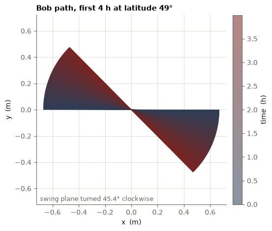
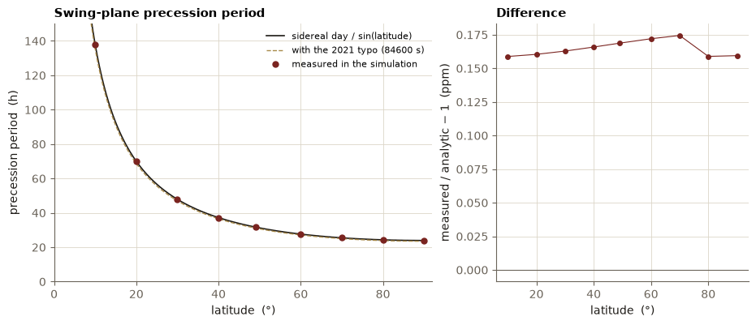

# Foucault Pendulum Simulation

**C++17 solver and Python tools for the Foucault pendulum: Coriolis-driven precession of the swing plane, integrated with fourth-order Runge-Kutta and checked against the closed-form solution.**

[](https://github.com/shahabahreini/foucault-pendulum/actions/workflows/ci.yml)
[](LICENSE)


**[Try the interactive model](https://shahabahreini.com/projects/foucault-pendulum/)**: change the latitude and watch the swing plane turn.



## In one paragraph

A pendulum that swings in a straight line seems to turn slowly when it hangs from a rotating Earth. The cause is
the Coriolis force, and the turn rate is Ω sin λ, with Ω the Earth's rotation rate and λ the latitude. This
repository integrates the equations of motion for a 67 m pendulum at 49° N, finds a precession period of
**31.71 h** (11.35° per hour, clockwise), and verifies it against the analytic value `T_sid / sin λ`.
It began as a 2021 UAlbany Computational Physics course project and has been rewritten with a tested core.

## Results

| Quantity | Value |
|---|---|
| Swing period, 2π√(L/g), L = 67 m | 16.40 s |
| Precession period at 49° | 31.71 h |
| Precession rate at 49° | 11.35 °/h, clockwise from above |
| Precession period at the pole / at 30° | 23.93 h / 47.87 h |
| RK4 error against the exact solution, dt = 0.1 s | 17 µm after one hour |
| Measured against analytic precession period (10°-90°) | within 20 ppm |
| Simplified against full model, Earth's Ω | about 10⁻⁶ m after one hour |



The 2021 code used 84600 s for Earth's rotation period, a typo for the 86400 s solar day. The effect depends on the
rotation against the stars, the sidereal day of 86164.09 s, which this version uses. The change shifts every
precession period by 1.8%. See [docs/errata.md](docs/errata.md).

## Quick start

```bash
git clone https://github.com/shahabahreini/foucault-pendulum.git
cd foucault-pendulum
cmake -S . -B build && cmake --build build
ctest --test-dir build --output-on-failure

# a one-hour run at 49 N, written to a file
./build/foucault-sim --lat 49 --hours 1 --out trace.tsv
```

`foucault-sim --help` lists every option. The most useful ones:

| Option | Meaning | Default |
|---|---|---|
| `--lat DEG` | latitude, north positive | 49 |
| `--length M` | pendulum length | 67 |
| `--amplitude M` | release distance | length / 100 |
| `--hours H`, `--duration S` | simulated time | 3500 s |
| `--dt S` | time step | 0.1 |
| `--model simplified\|full` | with or without the Ω² terms | simplified |
| `--omega-scale K` | multiply Ω to exaggerate the effect | 1 |
| `--legacy-day` | Ω from 84600 s, as in the 2021 code | off |
| `--stride N`, `--velocities` | thin or extend the output | 1, off |

Output is tab-separated: `t[s]  x[m]  y[m]` with x north and y west.

### Python tools

```bash
cd python && pip install -e ".[test]" && pytest
foucault-plot all --bin ../build/foucault-sim --out ../figures
```

`foucault_tools` loads traces, computes the swing-plane angle from the turning points, evaluates the exact
solution and draws the figures in [`figures/`](figures).

```python
from foucault_tools import Params, simulate, plane_angle_deg

trace = simulate(Params(latitude_deg=49.0), duration=6 * 3600, stride=10)
t, x, y = trace.T
times, angle = plane_angle_deg(t, x, y)   # degrees, negative = clockwise
```

### As a C++ library

The core is header-only:

```cpp
#include "foucault/model.hpp"

foucault::Params p;          // 67 m, 49 N, released 0.67 m from rest
p.latitude_deg = 30.0;
foucault::Pendulum pendulum(p);
foucault::State s = pendulum.initial();
for (int i = 0; i < 36000; ++i) s = pendulum.step(s);   // one hour at dt = 0.1 s
```

## The model

In the Earth-fixed frame, with x north, y west and z up, a bob under small swings obeys

```
x'' - 2 Ω sin λ y' + (g/L) x = 0
y'' + 2 Ω sin λ x' + (g/L) y = 0
```

The mass cancels. The second term in each equation is the Coriolis force, and only the vertical part of Ω,
Ω sin λ, enters. With ζ = x + iy the pair has the closed-form solution

```
ζ(t) = a e^(-iΩ sin λ t) [cos(w t) + i (Ω sin λ / w) sin(w t)],   w = sqrt(g/L + (Ω sin λ)²)
```

so the swing plane turns at Ω sin λ and the period of the turn is `T_sid / sin λ`. The derivation, the full model
with centrifugal terms, the numerical method and its limits are in [docs/method.md](docs/method.md).

## Tests

| Check | What it proves |
|---|---|
| Exact solution | RK4 matches the closed form to better than 0.05 mm over an hour |
| Convergence | halving dt cuts the error by 16 (fourth order) |
| Precession | plane angle matches −Ω sin λ · t at 10°, 49° and 90°; sign flips in the south; equator stays in plane |
| Models | simplified and full agree at Earth's Ω and separate at 300 × Ω |
| 2021 regression | `--legacy-day` reproduces the original output files to six digits |
| Validation | bad latitude, length, step or amplitude is rejected |

## Repository layout

```
include/foucault/   header-only core: params, model, rk4
src/main.cpp        foucault-sim command line tool
tests/              CTest executables
python/             foucault-tools package and foucault-plot
data/reference/     2021 outputs, used as a regression fixture
docs/               method, notes on the 2021 report, references
figures/            plots drawn by foucault-plot
```

## Limits

This is a small-angle model without air drag or wire stiffness, released from rest. It reproduces the ideal
precession; real pendulums also lose amplitude and pick up an elliptical motion (Airy precession), which are
not modelled. See [docs/method.md](docs/method.md), section 7.

## Citation

If you use this code, cite it with [CITATION.cff](CITATION.cff) (GitHub shows a "Cite this repository" button).
The background reading is in [docs/references.md](docs/references.md).

## License

[MIT](LICENSE), © Shahab Bahreini Jangjoo.
